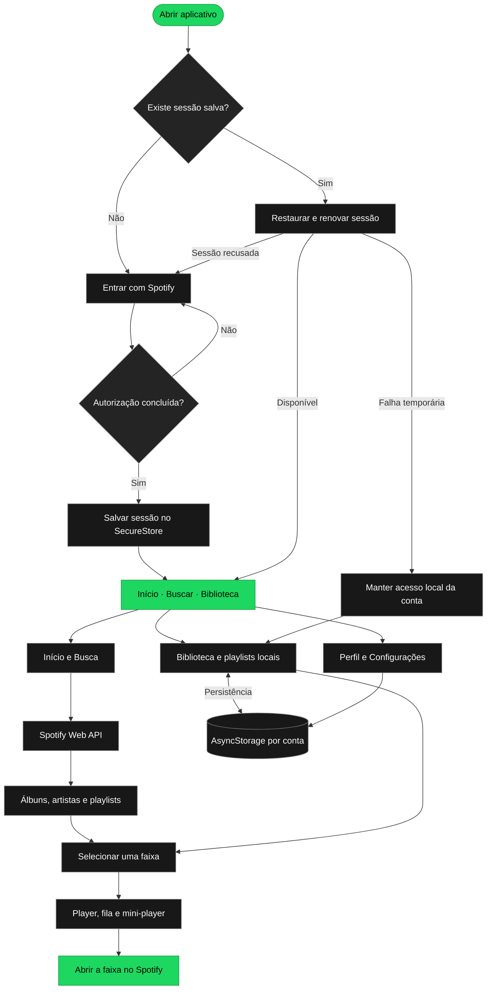

# Spotify Expo

Aplicativo acadêmico em React Native e Expo, com interface inspirada no Spotify, **17 telas navegáveis**, catálogo da Spotify Web API e dados locais separados por conta.

## Funcionalidades

- Login Spotify com PKCE, restauração da sessão e renovação de tokens.
- Home, busca com filtros, álbuns, artistas e playlists com dados reais.
- Curtidas, buscas recentes, artistas acompanhados e preferências persistentes.
- Playlists locais: criar, adicionar faixas, renomear, remover e excluir.
- Perfil da conta, apelido local, grade/lista e ordenação da Biblioteca.
- Faixa selecionada, mini-player e fila com anterior, próxima e seleção direta.
- Tratamento de erros e acesso aos dados locais já salvos sem conexão.

**A reprodução acontece no Spotify.** O botão Ouvir no Spotify abre a faixa no aplicativo oficial ou no navegador. Este projeto não reproduz áudio internamente nem baixa músicas para ouvir offline.

## Como funciona



O GitHub renderiza o fluxograma automaticamente. No Android, tokens são guardados no SecureStore; os dados pessoais do aplicativo ficam no AsyncStorage. No navegador, a sessão permanece somente em memória.

## Tecnologias

React 19, React Native 0.86, Expo SDK 57, Expo Router, StyleSheet/Flexbox, AsyncStorage, SecureStore, AuthSession e MaterialCommunityIcons.

## Preparar o ambiente

Use Node.js 24 e npm. Para testar o login, tenha uma conta Spotify autorizada no aplicativo cadastrado no Spotify for Developers.

```powershell
git clone https://github.com/GuiMell0/Spotify-Expo.git
cd Spotify-Expo
npm ci
if (-not (Test-Path -LiteralPath '.env')) {
    Copy-Item -LiteralPath '.env.example' -Destination '.env'
}
```

### Configurar o Spotify

1. Abra o [Spotify for Developers](https://developer.spotify.com/dashboard) e crie ou selecione o aplicativo.
2. Cadastre o retorno Android: `spotifyexpo-login://callback`.
3. Para testar no navegador do computador, cadastre também `http://127.0.0.1:8081/callback`.
4. Autorize as contas de teste conforme as permissões disponíveis no painel.
5. Copie somente o Client ID para o arquivo `.env`:

```dotenv
EXPO_PUBLIC_SPOTIFY_CLIENT_ID=seu_client_id
EXPO_PUBLIC_SPOTIFY_REDIRECT_URI_ANDROID=spotifyexpo-login://callback
EXPO_PUBLIC_SPOTIFY_REDIRECT_URI_WEB=http://127.0.0.1:8081/callback
```

Substitua `seu_client_id` pelo identificador do aplicativo. O fluxo utilizado é Authorization Code com PKCE: **não é necessário Client Secret no cliente**. Não coloque senhas, tokens ou Client Secret no código, em `EXPO_PUBLIC` ou no Git.

### Executar no Android durante o desenvolvimento

O login usa um retorno nativo e precisa de um APK com as bibliotecas do projeto. **Expo Go não é compatível com esse login.**

Na primeira instalação, entre no EAS com uma conta que tenha acesso ao projeto vinculado e gere um development build:

```powershell
npx eas-cli login
npx eas-cli build --platform android --profile development
```

Instale o APK gerado no Android e inicie o servidor:

```powershell
npm run dev
```

Mantenha computador e celular na mesma rede. Se necessário, use `npm run dev -- --tunnel`. Depois de adicionar dependências nativas ou alterar configurações Android, gere outro APK de desenvolvimento.

### Executar no navegador

```powershell
npm run web
```

Abra **http://127.0.0.1:8081**, correspondente ao retorno cadastrado. Se outra porta for utilizada, ajuste a origem e o retorno no painel e no `.env`. O endereço de loopback é para o navegador do computador, não para acessar o computador pelo celular.

## Gerar o APK independente

O perfil `preview` gera um APK que abre sem computador, Metro ou Expo Go:

```powershell
npx eas-cli build --platform android --profile preview
```

No ambiente `preview` do projeto EAS, configure as variáveis públicas `EXPO_PUBLIC_SPOTIFY_CLIENT_ID` e `EXPO_PUBLIC_SPOTIFY_REDIRECT_URI_ANDROID`. O `.env` local não é versionado.

Quando a compilação estiver **Finished**, baixe o arquivo `.apk` pelo link do EAS e instale no celular. Para preservar os dados de uma instalação existente, atualize com o mesmo pacote Android e a mesma assinatura.

Uma mudança no código incluído, nas dependências nativas ou no ícone precisa estar presente na nova compilação para aparecer no APK independente.

## Telas e navegação

| Tela | Rota |
| --- | --- |
| Login | /login |
| Início | /home |
| Buscar | /search |
| Biblioteca | /library |
| Álbum | /album/[id] |
| Artista | /artist/[id] |
| Playlist Spotify | /playlist/[id] |
| Player | /player?trackId=… |
| Perfil | /profile |
| Músicas curtidas | /liked |
| Buscas recentes | /recent-searches |
| Criar playlist local | /local-playlist/new |
| Playlist local | /local-playlist/[id] |
| Editar playlist local | /local-playlist/[id]/edit |
| Adicionar faixa à playlist | /add-to-playlist?trackId=… |
| Editar apelido | /profile/edit |
| Configurações | /settings |

As rotas ficam em `app/`, com Tabs, Stack e parâmetros dinâmicos. A entrada é `expo-router/entry`; não existe `App.js` concorrente. Callback OAuth, redirecionamento inicial e página inexistente não entram na contagem de telas.

## Organização

```text
app/                  Rotas e layouts do Expo Router
assets/icons/         Ícones do aplicativo
src/components/       Componentes reutilizáveis
src/config/           Configuração pública do Spotify
src/contexts/         Sessão, dados locais, catálogo e seleção de faixas
src/hooks/            Integrações compartilhadas entre as telas
src/screens/          Telas do aplicativo
src/services/         API, autenticação e regras das funcionalidades
src/storage/          Validação e persistência por conta
src/theme/            Cores, espaçamentos e estilos
tests/                Testes unitários com dados e respostas simuladas
```

O aplicativo usa dados reais da API e registros locais da conta. As respostas simuladas ficam restritas aos testes; não existe modo de demonstração no aplicativo.

## Validação

```powershell
npm test
npm run lint
npx expo install --check
npx expo-doctor
```

## Dados locais e limitações

- Curtidas, histórico, playlists, artistas acompanhados e preferências são separados pelo ID da conta.
- As playlists locais e o acompanhamento local não alteram a conta Spotify.
- A fila fica na memória da sessão e é limpa ao sair ou reiniciar.
- Primeira autorização, novos resultados do catálogo e capas remotas dependem de conexão.
- Uma falha temporária na renovação preserva o acesso aos dados locais da conta salva. Uma sessão rejeitada exige novo login.
- Conteúdos e endpoints dependem da disponibilidade e das permissões da conta no Spotify.

## Vídeo demonstrativo
- Link do Vídeo: https://drive.google.com/file/d/1_hOiZPvKmBWbZvJwF1ss5TMRm0YrzQ7d/view?usp=drive_link

## Integrantes e créditos

**Ana Carolina Gomes Soares** e **Guilherme Viana Ramos Mello**.

Projeto acadêmico, sem vínculo oficial com o Spotify. Marcas e conteúdos pertencem aos respectivos titulares. O ícone usa o glifo Spotify de MaterialCommunityIcons, distribuído por `@expo/vector-icons`. A licença da base do projeto está em [LICENSE](LICENSE).
